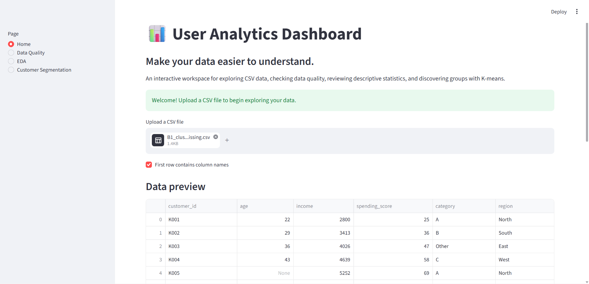
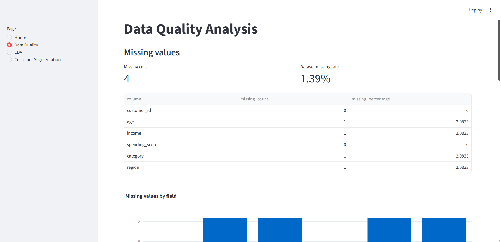
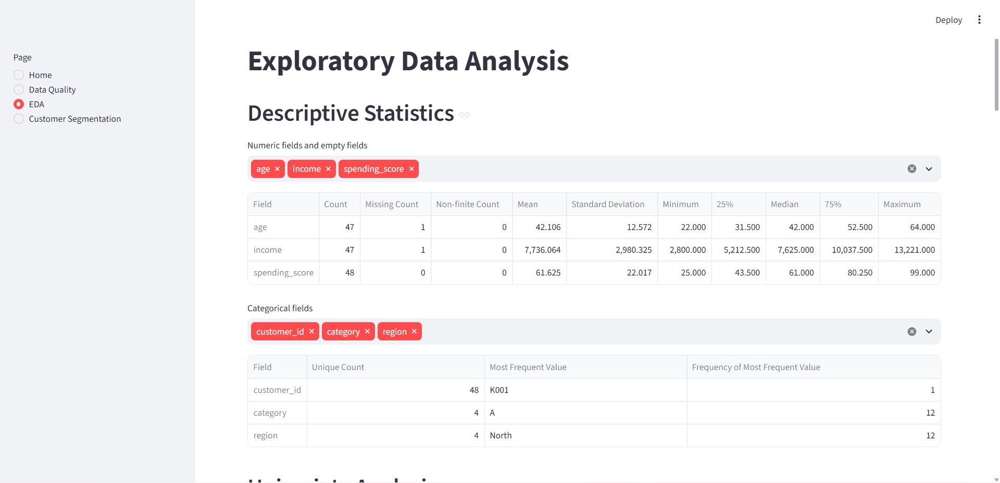
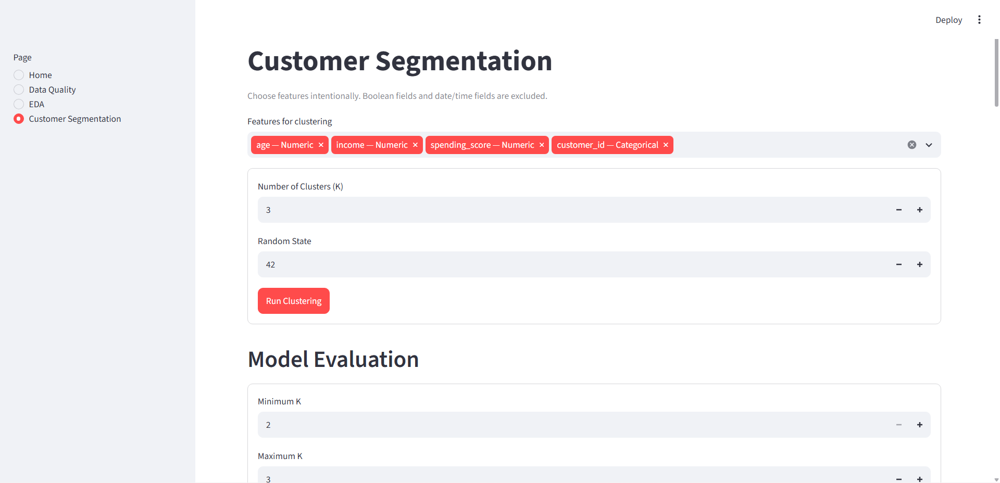
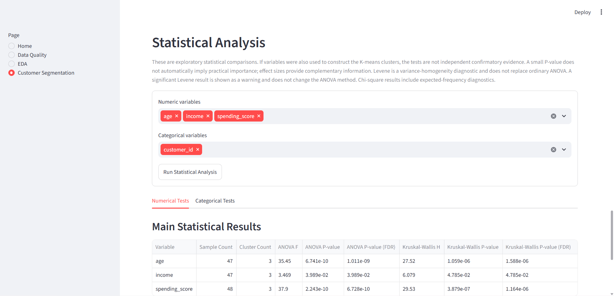
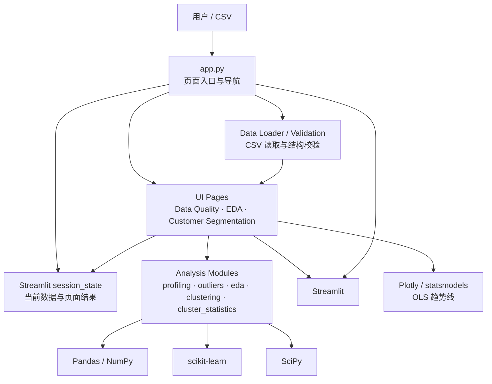

# Interactive Customer Analytics Platform

- **Live Demo:** [在线体验 Streamlit 应用](https://user-analytics-mingyu.streamlit.app/)
- **GitHub Repository:** [查看项目源代码](https://github.com/MingyuLiBW/user-analytics)

> An interactive Python application for data quality assessment, exploratory data analysis, customer segmentation, and statistical profiling.

Interactive Customer Analytics Platform 是一个基于 Python 和 Streamlit 的 CSV 数据分析应用。用户可以上传 CSV，依次检查数据质量、探索字段分布与变量关系、使用 K-means 进行客户分群，并通过 PCA、Cluster Profile 和统计检验查看分群结果。

```text
CSV 上传 → 数据质量检查 → EDA → K-means 客户分群 → PCA 可视化 → Cluster Profile → Statistical Analysis
```

## 应用预览

以下为应用页面截图，图片均位于 `assets/screenshots/`。

### Home / CSV Upload



### Data Quality



### EDA



### Customer Segmentation



### Cluster Insights



## 核心功能

### Home / CSV Upload

- 上传 CSV 并选择首行是否包含列名。
- 查看前 10 行、总行列数、字段名称和 Pandas 数据类型。
- 页面切换时保留当前会话中的有效数据；替换或清除上传文件时同步失效旧分析结果。

### Data Quality

- 检查每列及整个数据集的缺失值数量和比例。
- 统计完全重复行，但不自动删除记录。
- 展示字段 dtype 和字段类型分类。
- 使用 IQR 方法标记数值潜在异常值，不修改源数据。

### EDA

- 查看数值字段描述统计和类别字段频数统计。
- 使用直方图、箱线图和类别频数图进行单变量分析。
- 通过散点图、箱线图/小提琴图和类别分组图探索双变量关系。
- 查看 Pearson 或 Spearman 相关矩阵与热力图；数值散点图可选 OLS 趋势线。

### Customer Segmentation

- 选择数值与类别特征，配置 K-means 的簇数和随机种子。
- 评估多个 K 值的 Inertia（Elbow）和 Silhouette Score。
- 查看 PCA 二维投影、Cluster Profile 数值与类别画像，以及 Statistical Analysis 检验结果和效应量。
- 聚类计算结果保存在当前 Streamlit 会话中，并在输入数据或聚类设置变化后进行有效性检查。

## 分析方法与注意事项

### 聚类预处理与 PCA

- 数值字段的缺失值使用中位数填补，再使用 `StandardScaler` 标准化。
- 类别字段的缺失值使用众数填补；全缺失类别列使用 `**MISSING**` 占位类别，再使用 `OneHotEncoder` 编码。One-Hot 结果不再标准化，并允许安全处理未知类别。
- 布尔和日期字段不作为普通聚类特征；数值聚类特征含 `+Inf` 或 `-Inf` 时会拒绝预处理，`NaN` 则按既定策略填补。
- PCA 使用已经预处理的特征矩阵降至二维，仅用于结果可视化，不改变 K-means 标签。

### 缺失值与非有限数值

数值分析中，有限数值参与统计；`NaN` 计入 Missing Count，正负无穷值计入 Non-finite Count，并从相应数值统计或图表中排除。原始上传 DataFrame 不会因这些分析而被修改。分类字段仍按类别值处理，字符串 `"inf"` 不会被解释为数值无穷大。

### 数据质量、相关性与统计检验

- 潜在异常值使用 IQR 规则：上下界分别为 `Q1 - 1.5 × IQR` 与 `Q3 + 1.5 × IQR`。异常标记不等同于数据错误，也不会触发自动删除。
- 相关分析支持 Pearson 和 Spearman，并使用成对有效的有限观测。相关性不代表因果关系。
- 分群统计包括 One-way ANOVA、Levene 方差齐性诊断、Kruskal-Wallis 和 Chi-square；同时提供 Eta-squared、Epsilon-squared、Cramér's V 与 Benjamini-Hochberg FDR 调整。
- 这些分群检验属于探索性分析。若用于构造 K-means 簇的特征也参与组间检验，检验结果不能解释为独立的确认性证据。小 P-value 不自动代表实际影响重要；应结合效应量、检验状态和诊断信息解读。Levene 是方差齐性诊断，不会静默替换普通 ANOVA；Chi-square 结果会附带期望频数诊断。

## 系统架构

应用采用 Streamlit 单进程架构，没有单独的 API 服务或数据库。`app.py` 负责页面配置、导航和上传流程；页面将当前 DataFrame 交给数据加载/校验和分析函数，再由 Streamlit 展示结果。



## 技术栈

- **语言与运行环境：** Python 3.10、3.11
- **Web 应用：** Streamlit
- **数据处理：** Pandas、NumPy
- **机器学习：** scikit-learn
- **统计分析：** SciPy
- **交互式图表：** Plotly
- **OLS 趋势线：** statsmodels（运行依赖约束 `>=0.14,<0.15`）
- **测试：** pytest
- **打包：** setuptools，`src` layout；依赖统一在 `pyproject.toml` 声明

## 快速开始

以下命令适用于 Windows PowerShell，请在项目根目录执行。项目支持 Python `>=3.10,<3.12`（Python 3.10 或 3.11）。

```powershell
# 创建 Python 3.10 虚拟环境；若使用 Python 3.11，请将此命令改为 py -3.11 -m venv .venv
py -3.10 -m venv .venv

# 激活虚拟环境
.\.venv\Scripts\Activate.ps1

# 更新 pip 并安装项目和测试依赖
python -m pip install --upgrade pip
python -m pip install -e ".[test]"

# 启动应用
python -m streamlit run app.py
```

如果相应的 `py -3.10` 或 `py -3.11` 命令不可用，请将下面的示例路径替换为本机所选解释器的实际路径。示例使用 Python 3.11；选择 Python 3.10 时，将路径中的 `Python311` 改为本机对应目录：

```powershell
& "C:\Path\To\Python311\python.exe" -m venv .venv
```

Streamlit 启动后通常可通过 <http://localhost:8501> 访问，并会持续占用当前终端。运行测试时可另开 PowerShell 窗口并激活 `.venv`，或按 `Ctrl+C` 停止应用后执行：

```powershell
python -m pytest -q
```

`pyproject.toml` 是依赖配置的唯一来源，`.[test]` 会安装 pytest 测试依赖。`requirements.txt` 仅作为兼容安装入口，可在项目根目录使用 `python -m pip install -r requirements.txt`。

## CSV 数据要求与限制

- 仅接受 CSV 文件；单文件上传大小上限为 **50 MB**，由 Streamlit 上传配置和后端 loader 共同检查。
- 支持 UTF-8 BOM；上传时可指定首行是否包含列名。
- 每条逻辑记录的字段数必须符合 CSV 表结构；结构不一致、空文件或无法解析的文件会被拒绝并给出错误提示。
- 应用不会自动删除重复行、缺失记录或 IQR 标记的潜在异常值。
- 聚类要求至少选择两个适用特征；布尔和日期字段不作为普通聚类特征，含正负无穷的数值聚类字段会被拒绝。

## 项目目录结构

```text
User_Analytics/
├── app.py
├── pyproject.toml
├── requirements.txt
├── README.md
├── .streamlit/
│   └── config.toml
├── assets/
│   └── screenshots/
│       └── README.md
├── data/
│   └── .gitkeep
├── src/
│   └── user_analytics/
│       ├── config.py
│       ├── data/
│       │   ├── loader.py
│       │   └── validation.py
│       ├── analysis/
│       │   ├── profiling.py
│       │   ├── outliers.py
│       │   ├── eda.py
│       │   ├── clustering.py
│       │   └── cluster_statistics.py
│       └── ui/
│           ├── upload_state.py
│           └── pages/
│               ├── data_quality.py
│               ├── eda.py
│               └── customer_segmentation.py
└── tests/
```

`data/` 用于本地数据；本地上传数据和敏感配置应遵循 `.gitignore`，不要提交到版本库。

## 自动化测试

使用 pytest 运行全量测试：

```powershell
python -m pytest -q
```

当前版本最近一次已验证的全量测试记录为 **140 passed**。这是该次运行的结果记录，不代表后续代码版本或环境一定保持相同数量。

## 已知限制与后续计划

- 应用当前以本地 Streamlit 方式运行；README 不声明已经部署线上服务。
- 文件上传上限为 50 MB；大文件分析和性能扩展不属于当前版本承诺。
- 统计检验结果是探索性分析，特别是聚类输入特征参与检验时，不构成独立确认性推断。
- 后续工作以工程化收尾、依赖与部署配置检查、文档完善及部署准备为主；是否以及何时部署仍待确认。
